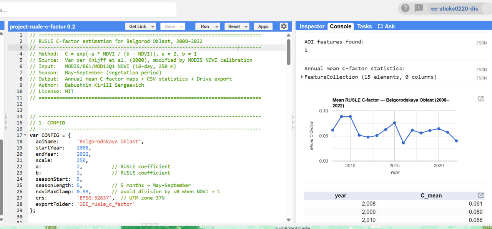

# RUSLE C-factor — Belgorod Oblast (2008–2022)

Пайплайн для автоматического расчёта C-фактора (фактор растительности и управления) 
из уравнения RUSLE по данным MODIS NDVI через Google Earth Engine.


## Что делает

- Загружает MODIS MOD13Q1 NDVI (16-day, 250 m) за 2008–2022
- Маскирует облака и снег по SummaryQA
- Считает средний NDVI за вегетационный сезон (май–сентябрь)
- Применяет формулу Van der Knijff et al. (2000): `C = exp(-2 · NDVI / (1 - NDVI))`
- Экспортирует 15 растров (GeoTIFF) + CSV со статистикой в Google Drive
- Строит временной ряд и считает тренд (Mann-Kendall)

## Результат

| Метрика | Значение |
|---|---|
| Средний C-фактор | 0.060 ± 0.015 |
| Диапазон | 0.036 (2016) — 0.089 (2009) |
| Тренд (Mann-Kendall) | нет (p = 0.235) |

## Стек

- **Python 3.13** — основной язык
- **earthengine-api** — доступ к GEE
- **geemap** — визуализация карт
- **pandas, matplotlib** — анализ и графики
- **pymannkendall** — статистика тренда
- **JupyterLab** — среда разработки

## Структура проекта

```
project-rusle-c-factor/
├── assets/               # статика для README (скриншоты, схемы)
├── data/                 # CSV с результатами
├── figures/              # графики
├── gee/                  # версия скрипта для GEE Code Editor (JS)
├── python/
│   ├── utils.py          # общие функции
│   ├── 01_compute.ipynb  # расчёт + экспорт
│   └── 02_analysis.ipynb # анализ тренда
├── output/               # промежуточные результаты
└── README.md
```

## Как запустить

### 1. Установка

```bash
pip install earthengine-api geemap pandas matplotlib pymannkendall
```

### 2. Аутентификация в GEE (один раз)

```bash
earthengine authenticate
```

### 3. Запуск

```bash
cd python/
jupyter lab 01_compute.ipynb
```

Ноутбук `01_compute.ipynb` отправит 16 задач в GEE Tasks. После выполнения 
файлы появятся в Google Drive → папка `GEE_rusle_c_factor`.

Затем откройте `02_analysis.ipynb` для анализа тренда.

## Метод

C-фактор рассчитывается по эмпирической формуле Van der Knijff et al. (2000):

```
C = exp(-a · NDVI / (b - NDVI))
```

где `a = 2`, `b = 1` — коэффициенты для европейских условий. 
NDVI — средний за вегетационный сезон (май–сентябрь).

## Адаптация под другой регион

Пайплайн универсален. Для другого региона нужно поменять:

| Параметр | Где | Комментарий |
|---|---|---|
| `aoiName` | CONFIG | Название ADM1-региона в GAUL 2015 |
| `crs` | CONFIG | UTM-зона территории (например, EPSG:32637) |
| `seasonStart`, `seasonLength` | CONFIG | Под климат: май–сентябрь для умеренной зоны |
| `startYear`, `endYear` | CONFIG | MOD13Q1 доступен с 2000 года |
| `a`, `b` | CONFIG | Коэффициенты под биом |

## Ограничения

- **Коэффициенты a=2, b=1 взяты как есть**, без региональной калибровки. 
  Литература (Буряк и др., 2023) показывает, что для Белгородской области 
  формула систематически **занижает** C-фактор примерно в 2.16 раза.
- **Значения даны для всей территории области** (включая лес и луга). 
  Для эрозионных расчётов на пашне нужно наложить маску сельхозугодий.
- **Период 15 лет** — короткий для климатического тренда. 
  Отсутствие тренда статистически ожидаемо.

## Источники

- Van der Knijff, J.M., Jones, R.J.A., Montanarella, L. (2000). 
  *Soil erosion risk assessment in Europe*. EUR 19044 EN.
- Буряк Ж.А., Нарожняя А.Г., Маринина О.А. (2023). 
  *Эрозионная опасность пахотных земель Белгородской области*. 
  Региональные геосистемы.
- MODIS MOD13Q1: [developers.google.com/earth-engine/datasets](https://developers.google.com/earth-engine/datasets/catalog/MODIS_061_MOD13Q1)

## Лицензия

MIT

## Автор

**Бабушкин Кирилл Сергеевич**  
[GitHub](https://github.com/sticks0220) · [Telegram](https://t.me/kgis_dev) · sticks0220@gmail.com
